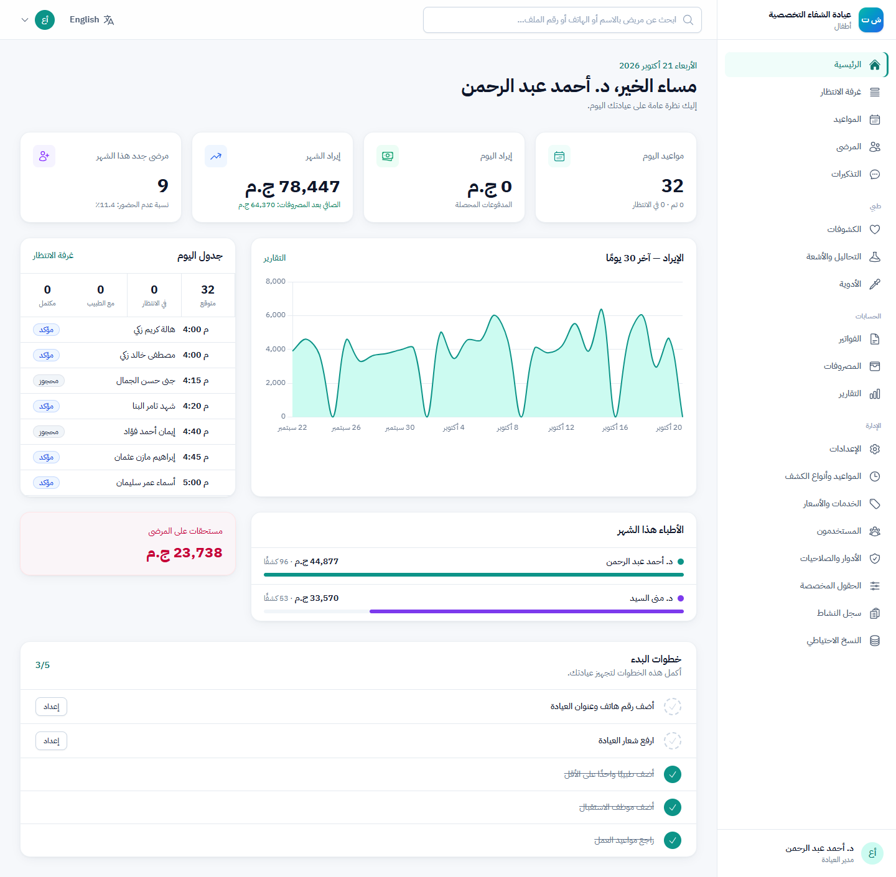
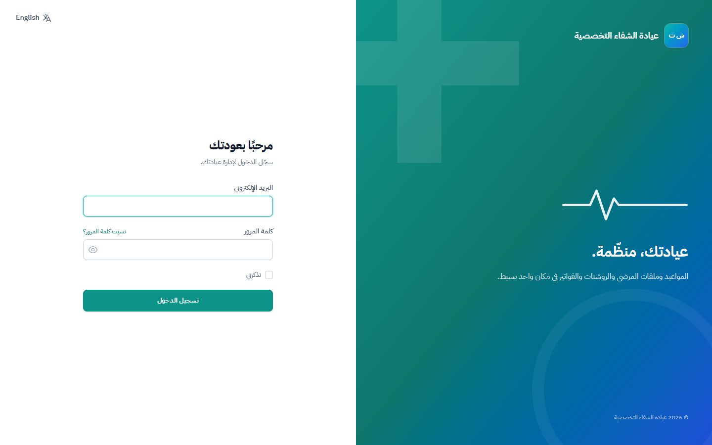
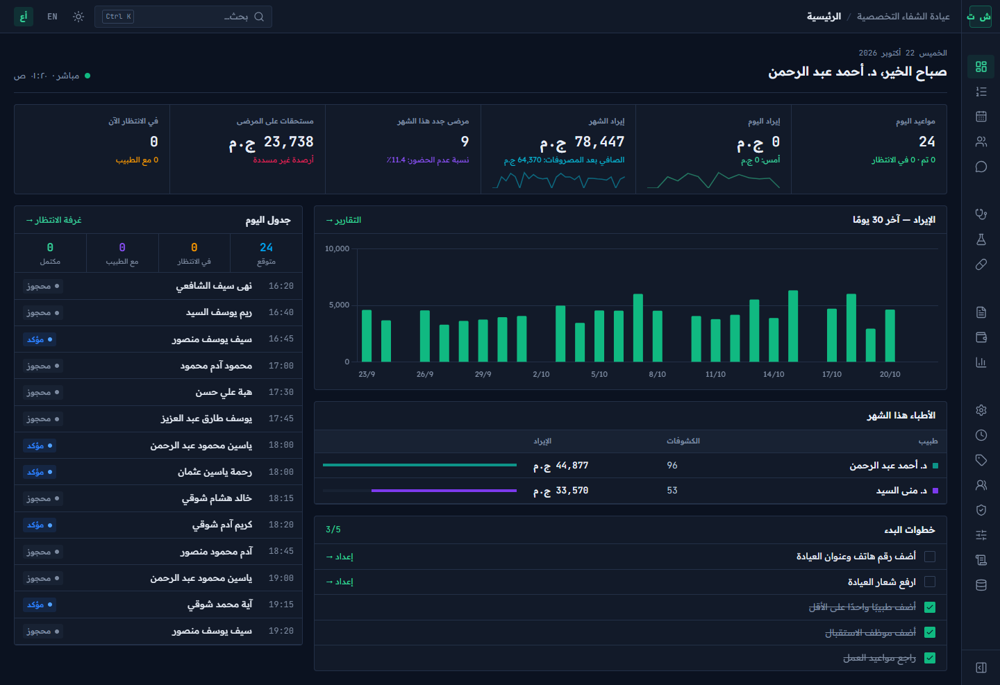
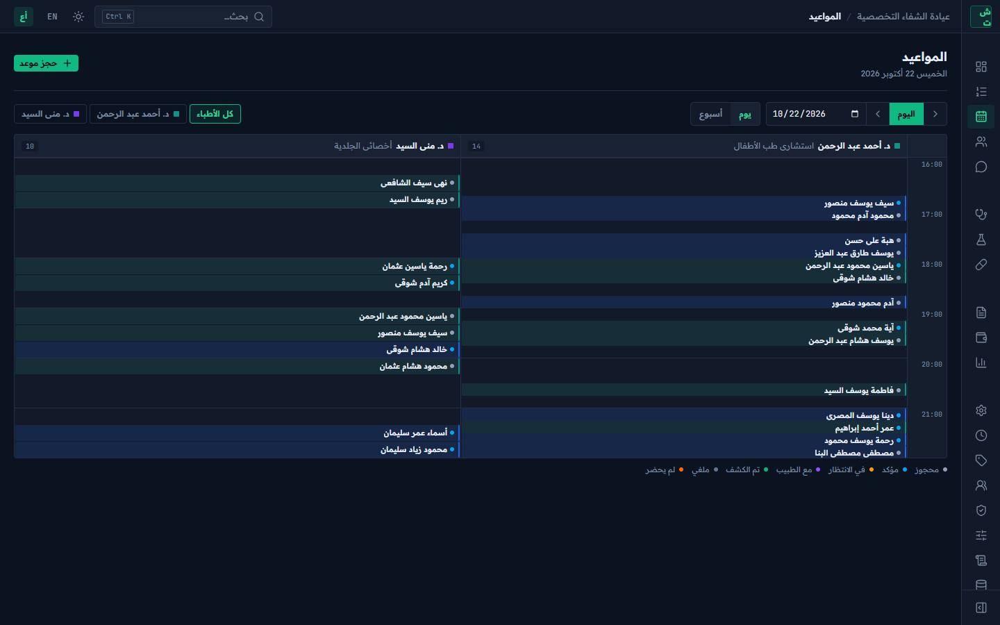
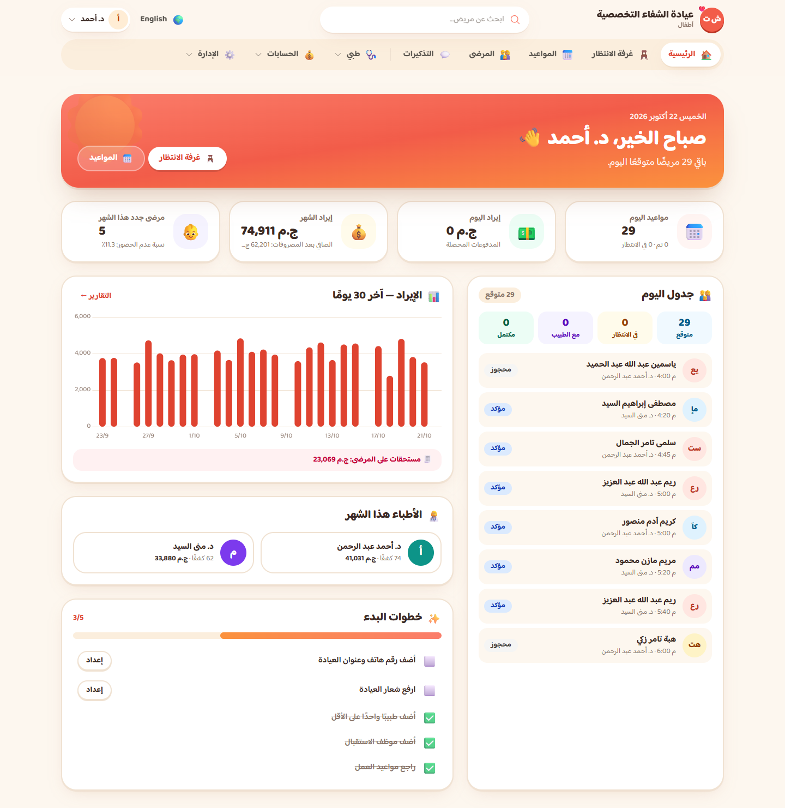
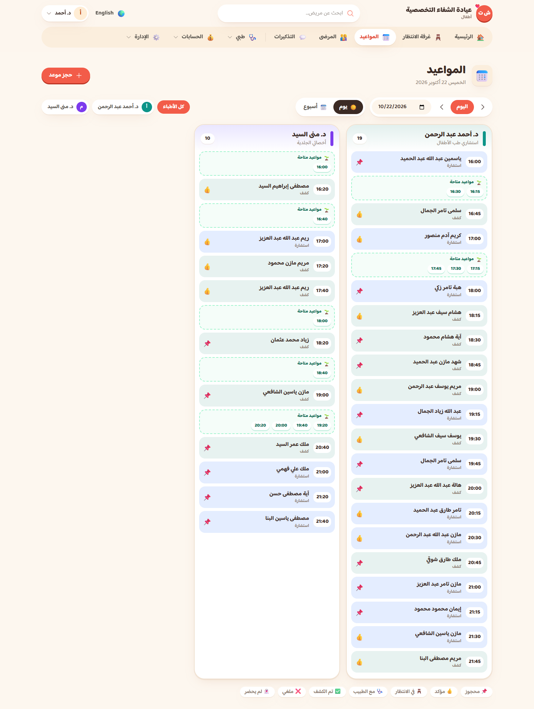
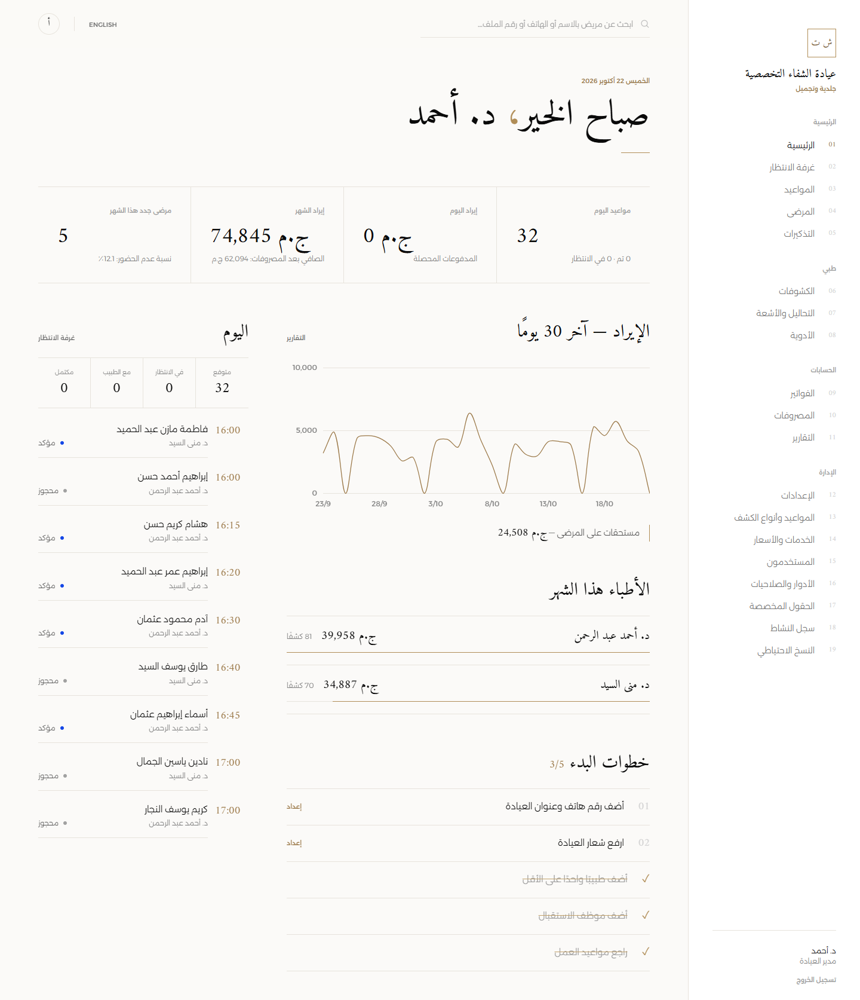
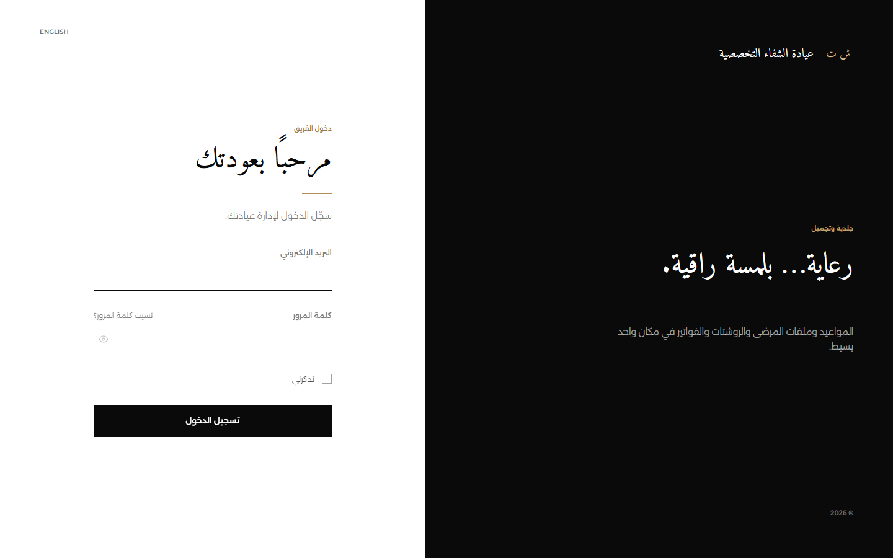
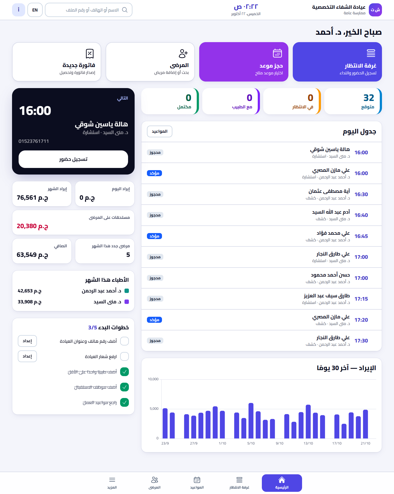
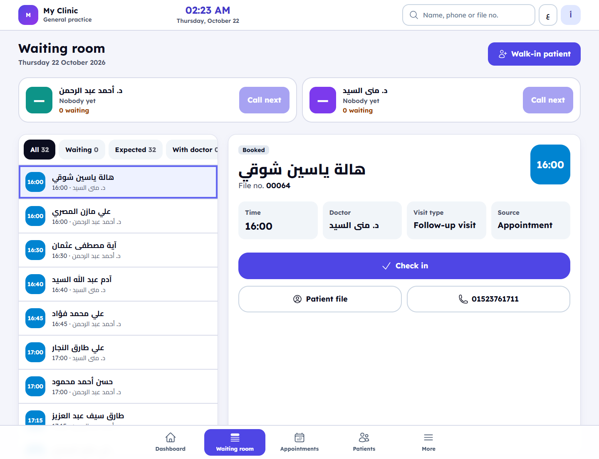

# نظام إدارة العيادات — 5 قوالب · Clinic Management System — 5 Templates

[العربية](#العربية) · [English](#english)

---

## العربية

خمسة مشاريع Laravel مستقلة **بنفس الخلفية البرمجية ونفس منطق العمل** (المرضى، المواعيد وغرفة الانتظار، الكشوفات والروشتات، التحاليل، الفواتير والمدفوعات، المصروفات والمخزون، التقارير، تذكيرات واتساب، الصلاحيات، سجل النشاط، النسخ الاحتياطي) — ويختلف كل قالب في **التصميم وتجربة الاستخدام بالكامل**: الألوان، الخطوط، شكل القائمة، لوحة التحكم، التقويم، ملف المريض، شاشة الدخول، وتصميمات الطباعة.

كل قالب جاهز للتشغيل وحده: انسخ مجلد القالب، واتبع ملف `README.md` بداخله، ثم شغّل `php artisan clinic:install`.

### المقارنة السريعة

| | القالب 1 | القالب 2 | القالب 3 | القالب 4 | القالب 5 |
|---|---|---|---|---|---|
| الاسم | **Clinical Clean** | **Dark Pro** | **Warm & Friendly** | **Luxury Minimal** | **Tablet-First Reception** |
| الطابع | طبي كلاسيكي نظيف | احترافي تقني | دافئ ومرح | فاخر وهادئ | عملي للاستقبال |
| الألوان | أبيض + فيروزي/أزرق | داكن افتراضيًا (مع وضع فاتح) + أخضر زمردي | كريمي + مرجاني/برتقالي | أسود/أبيض + ذهبي | نيلي/بنفسجي بتباين عالٍ |
| الخط العربي / الإنجليزي | IBM Plex Sans Arabic / Inter | Readex Pro / Manrope (+ JetBrains Mono) | Baloo Bhaijaan 2 / Nunito | Amiri + Alexandria / Cormorant Garamond + Jost | Cairo / Lexend |
| التنقل | قائمة جانبية يمين | شريط أيقونات قابل للطي + لوحة أوامر Ctrl+K | قائمة علوية أفقية | فهرس نصي جانبي مرقّم | شريط تبويبات سفلي + "المزيد" |
| الحواف | دائرية (بطاقات) | حادة ودقيقة | دائرية جدًا | حادة بخطوط رفيعة | دائرية وكبيرة للمس |
| التقويم | شبكة زمنية رأسية | أعمدة الأطباء بكثافة عالية | لوحة أجندة بملصقات وأوقات متاحة | دفتر بالساعات (Ledger) | خط زمني أفقي يُسحب بالإصبع |
| غرفة الانتظار | قوائم وبطاقات أطباء | لوحة 3 مسارات | تذاكر بوجوه تعبيرية لمدة الانتظار | قائمة "كونسيرج" بأرقام كبيرة | شاشة مقسومة: قائمة + تفاصيل بأزرار كبيرة |
| الطباعة | ترويسة كلاسيكية وخط فيروزي | شبكة أحادية اللون وشريط أسود | ترويسة كريمية دائرية | ترويسة ذهبية بخط Serif في المنتصف | خط كبير وتباين عالٍ |
| الأنسب لـ | العيادات العامة والباطنة وطب الأسرة | العيادات المزدحمة والمستخدمين المحترفين | الأطفال والأسنان وطب الأسرة | التجميل والجلدية والعيادات الراقية | العيادات التي يعمل استقبالها على تابلت |

### لقطات الشاشة

| القالب | لوحة التحكم | شاشة الدخول / شاشة مميزة |
|---|---|---|
| 1 — Clinical Clean |  |  |
| 2 — Dark Pro |  |  |
| 3 — Warm & Friendly |  |  |
| 4 — Luxury Minimal |  |  |
| 5 — Tablet-First |  |  |

> اللقطات من بيانات تجريبية (أسماء وهمية) يمكن تحميلها بـ `php artisan clinic:install --demo`.

### المشترك بين كل القوالب

- Laravel 13 و PHP 8.3+ و Livewire 4 و Alpine و Tailwind 4 و MySQL، مع Pest للاختبارات.
- العربية افتراضيًا (من اليمين لليسار) والإنجليزية حسب كل مستخدم.
- 4 أدوار: المدير، الطبيب، الاستقبال (لا يرى البيانات الطبية)، المحاسب. والصلاحيات قابلة للتعديل.
- كل إعدادات العيادة في قاعدة البيانات، ولا يوجد شيء مكتوب في الكود: الاسم، الشعار، اللون، التخصص، الحقول المخصصة، والوحدات (المعمل/المصروفات/المخزون).
- نسخ احتياطي يومي، وسجل نشاط، وأكثر من 185 اختبارًا آليًا في كل قالب.

### تطوير الخلفية لكل القوالب

عدّل الخلفية في قالب واحد (عادةً القالب 1) وشغّل اختباراته، ثم انسخ التعديل للباقي:

```powershell
./tools/sync-backend.ps1 -DryRun      # معاينة
./tools/sync-backend.ps1              # من القالب 1 إلى 2–5
./tools/sync-backend.ps1 -From 1 -To 3,4
```

السكربت ينسخ: `app` و`bootstrap` و`config` و`database` و`routes` و`tests` وملفات الترجمة PHP، ويدمج `lang/ar.json` مع الحفاظ على نصوص كل قالب. ولا يلمس أبدًا: `resources/` و`vite.config.js` و`DESIGN.md` و`README.md` والملفات الخاصة بالقالب 2 (لوحة الأوامر). بعد النسخ شغّل `./vendor/bin/pest` في كل قالب.

---

## English

Five independent Laravel projects that share **the same backend and business logic**: patients, appointments and waiting room, visits and prescriptions, lab, invoices and payments, expenses and inventory, reports, WhatsApp reminders, roles, the activity log and backups. Each one has a **completely different design and UX**: palette, fonts, navigation, dashboard, calendar, patient profile, login page and print designs.

Each template stands alone: copy its folder, follow the `README.md` inside, then run `php artisan clinic:install`.

### At a glance

| | Template 1 | Template 2 | Template 3 | Template 4 | Template 5 |
|---|---|---|---|---|---|
| Name | **Clinical Clean** | **Dark Pro** | **Warm & Friendly** | **Luxury Minimal** | **Tablet-First Reception** |
| Mood | Classic, clean medical | Modern, tech-forward | Cosy, cheerful | Editorial, high-end | Practical, front-desk |
| Palette | White + teal/blue | Dark by default (light toggle), navy/graphite + emerald | Cream + coral/orange | Black/white + gold | High-contrast indigo/purple |
| Arabic / English fonts | IBM Plex Sans Arabic / Inter | Readex Pro / Manrope (+ JetBrains Mono) | Baloo Bhaijaan 2 / Nunito | Amiri + Alexandria / Cormorant Garamond + Jost | Cairo / Lexend |
| Navigation | Right sidebar (RTL) | Collapsible icon rail + Ctrl/⌘+K command palette | Horizontal top nav with dropdown groups | Numbered, text-only index sidebar | Bottom tab bar + "More" sheet |
| Shape | Rounded cards, soft shadows | Sharp, dense, hairlines | Very rounded, 3D pill buttons | Square, hairline, no shadows | Large rounded touch targets |
| Calendar | Vertical time grid | Dense doctor resource columns | Agenda board with "sticker" appointments and free-time chips | Hour-by-hour ledger | Horizontal swipeable timeline |
| Waiting room | Lists + doctor cards | Three-lane board | Ticket cards with wait-time mood emoji | Concierge list with giant serif numbers | Split screen: list + big-button detail panel |
| Print | Classic letterhead, teal rule | Monochrome grid, black band | Rounded cream letterhead, friendly lines | Centred serif letterhead, gold hairlines | Large high-contrast type |
| Best fit | General practice, internal medicine, family clinics | Busy clinics, power users, night shifts | Pediatrics, dental, family medicine | Aesthetic, dermatology, premium private practice | Clinics whose reception runs on a tablet |

### Screenshots

| Template | Dashboard | Login / signature screen |
|---|---|---|
| 1 — Clinical Clean |  |  |
| 2 — Dark Pro |  ([light](docs/screenshots/t2-dashboard-light.png)) |  |
| 3 — Warm & Friendly |  |  |
| 4 — Luxury Minimal |  |  |
| 5 — Tablet-First |  |  |

> The screenshots use the fictional Arabic demo data that `php artisan clinic:install --demo` loads.

### Shared by every template

- Laravel 13, PHP 8.3+, Livewire 4, Alpine, Tailwind 4 and MySQL, tested with Pest.
- Arabic (RTL) by default, with English per user.
- Four roles: Admin, Doctor, Receptionist (never sees medical notes) and Accountant. Permissions are editable.
- Nothing clinic-specific is hard-coded. Name, logo, color, specialty, custom fields and modules (lab, expenses, inventory) all live in the database.
- Daily backups, an activity log and 185+ automated tests per template.

### Changing the backend for all templates

Make the change in one template (usually template 1) and run its tests, then copy it to the others:

```powershell
./tools/sync-backend.ps1 -DryRun      # preview
./tools/sync-backend.ps1              # template 1 → 2–5
./tools/sync-backend.ps1 -From 1 -To 3,4
```

The script copies `app`, `bootstrap`, `config`, `database`, `routes`, `tests` and the PHP translation files, and merges `lang/ar.json` while keeping each template's own strings. It never touches `resources/`, `vite.config.js`, `DESIGN.md`, `README.md` or template 2's command palette files. Afterwards, run `./vendor/bin/pest` in every template.

### Repository layout

```
template_1 … template_5   five standalone Laravel apps (each with README.md + DESIGN.md)
tools/sync-backend.ps1    copy shared backend changes between templates
tools/merge-json.php      translation merge used by the sync script
docs/screenshots/         screenshots used above
PLAN.md                   the original build plan
```
